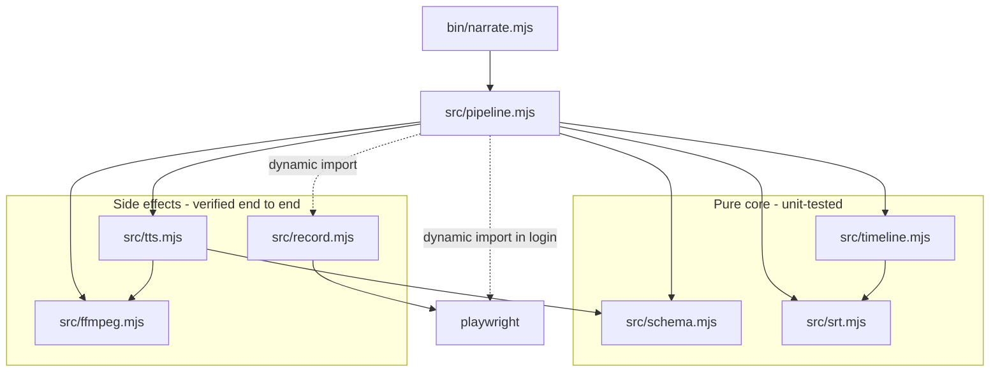
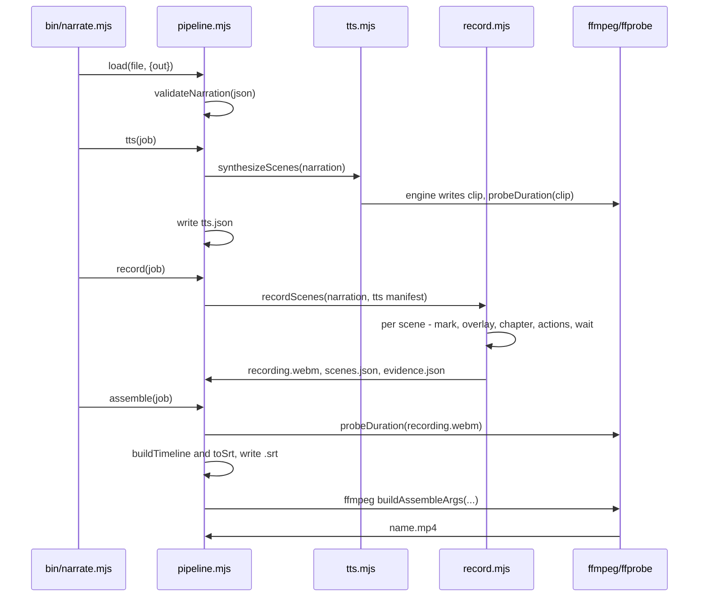

# Code flow

The code splits into a **pure core** (schema, timeline, SRT, ffmpeg argument builder) that is unit-tested, and **side-effecting modules** (TTS engines, Playwright recording, process spawning) that are verified end to end. `bin/narrate.mjs` parses arguments, `src/pipeline.mjs` runs each command, and the commands talk to each other only through JSON files in the working directory (`tts.json`, `scenes.json`).

For the user-facing process and the technologies, see [workflow.md](workflow.md).

## Module map

| File | Responsibility | Key exports |
|---|---|---|
| `bin/narrate.mjs` | Argument parsing, usage text, exit codes | `main` (bin/narrate.mjs:26), `USAGE` (bin/narrate.mjs:6) |
| `src/pipeline.mjs` | One function per command; file I/O between steps | `load` (src/pipeline.mjs:11), `tts` (:34), `record` (:40), `login` (:47), `assemble` (:71) |
| `src/schema.mjs` | Validates `narration.json` and applies defaults | `validateNarration` (src/schema.mjs:19), `ACTIONS` (:3), `ENGINES` (:7), `DEFAULT_VOICES` (:8); internal `validateAction` (:102) |
| `src/tts.mjs` | Engine order, cache, synthesis per scene | `engineOrder` (src/tts.mjs:11), `voiceFor` (:17), `cacheKey` (:21), `synthesize` (:60), `synthesizeScenes` (:79); internal `EXT` (:9), `engines` (:31) |
| `src/record.mjs` | Playwright recording, overlays, evidence capture | `recordScenes` (src/record.mjs:32), `captionHtml` (:17), `calloutHtml` (:23); internal `runAction` (:104) |
| `src/timeline.mjs` | Scene marks → video segments, audio placements, cues | `buildTimeline` (src/timeline.mjs:12) |
| `src/srt.mjs` | Cue splitting and SubRip formatting | `splitCue` (src/srt.mjs:6), `toSrt` (:50) |
| `src/ffmpeg.mjs` | ffmpeg argument builder, process runner, duration probe | `buildAssembleArgs` (src/ffmpeg.mjs:7), `run` (:34), `probeDuration` (:50) |

## Module dependencies



`src/ffmpeg.mjs` is mixed: `buildAssembleArgs` is pure and tested; `run` and `probeDuration` spawn processes. `record.mjs` and `playwright` are imported lazily (src/pipeline.mjs:41, :48), so `validate`, `tts` and `assemble` never load Playwright.

## `narrate run` sequence



## Command call paths

Every command except `login` starts with `load` (src/pipeline.mjs:11): resolve the path, strip a UTF-8 BOM, parse JSON (`<file>: invalid JSON (...)` on failure), call `validateNarration`, compute `workDir` (`--out` or `<script dir>/out/<name>`), create it, compute `output` (script `output` resolved from the script dir, or `<workDir>/<name>.mp4`) and `cacheDir` (`<script dir>/.cache/tts`).

| Command | Call path | Reads | Writes |
|---|---|---|---|
| `validate` | `main` → `load` → prints title, scene count, output and each scene's action count | script | nothing (creates `workDir`) |
| `tts` | `main` → `load` → `tts` → `synthesizeScenes` → `synthesize` per scene | script | `tts.json`, clips in `.cache/tts/` |
| `record` | `main` → `load` → `record` → `readJson(tts.json)` → `recordScenes` | `tts.json`, `actionsModule`, `storageState` | `recording.webm`, `scenes.json`, `evidence.json`, `*.png` |
| `assemble` | `main` → `load` → `assemble` → `probeDuration` → `buildTimeline` → `toSrt` → `run('ffmpeg', buildAssembleArgs(...))` | `tts.json`, `scenes.json`, `recording.webm` | `<name>.mp4`, `<name>.srt` next to it |
| `run` | `tts`, then `record`, then `assemble` in the same process | as above | as above |
| `login` | `main` → `login(url, save)` (no `load`) | nothing | `--save` file, default `.cache/auth/state.json` relative to the current directory |

A missing input file fails with `<path> not found; run "narrate tts" first` (or `"narrate record"`), from `readJson` (src/pipeline.mjs:29).

**Exit codes** (bin/narrate.mjs:26–76):

| Code | When |
|---|---|
| `0` | Success, or `-h` / `--help` / no command (prints usage) |
| `1` | Any thrown error, printed as `narrate: <message>` |
| `2` | Usage error: unknown command, missing file or URL, `--out` / `--save` without a value |

## Deep dives

### Schema validation (`src/schema.mjs`)

`validateNarration` collects **every** problem before failing, then throws one error:

```text
Invalid narration:
  - title: required string
  - scenes[0].actions[0]: unknown action "clik"
  - scenes[1].id: duplicate "a"
```

Paths use `field`, `parent.child` and `scenes[i].actions[j]` notation. Each action must be an object with exactly one key from `ACTIONS`; `validateAction` (src/schema.mjs:102) checks its value shape.

Defaults applied:

| Field | Default |
|---|---|
| `viewport` | `{ width: 1366, height: 768 }` |
| `tts` | `engine: 'edge'`, `voice: DEFAULT_VOICES[engine]`, `rate: '+0%'`, `fallback: true` |
| `browser` | `channel: 'chrome'`, `headless: true`, `locale: 'es-CO'`, `storageState` unset |
| `captions`, `showActions` | `true` |
| `gapMs` | `400` |
| scene `actions` / `speedup` | `[]` / `1` |

### TTS fallback chain and cache (`src/tts.mjs`)

1. `engineOrder(engine, fallback, env)` returns `[engine, ...the others in ENGINES order]` when `fallback` is on, else `[engine]`. Deepgram is removed when neither `DEEPGRAM_API_KEY` nor `DEEPGRAM_API_KEY_FILE` is set.
2. `voiceFor(tts, engine)` uses the configured voice only for the configured engine; fallback engines use `DEFAULT_VOICES`. An edge voice name is never sent to SAPI.
3. `synthesize` (src/tts.mjs:60) builds the file name `cacheKey({engine, voice, rate, text})` + `.` + `EXT[engine]`. The key is the first 16 hex characters of a SHA-256 over the four values joined by `\u0000`. If the file exists, synthesis is skipped (src/tts.mjs:67).
4. The clip is measured with `probeDuration`. Any error (synthesis or probe) moves to the next engine. A fallback is logged as `tts: fell back to <engine> (...)`. If every engine fails: `tts: every engine failed` plus one line per engine.
5. `synthesizeScenes` skips scenes without `say` and returns `{ [sceneId]: { file, duration, engine, voice } }`, which becomes `tts.json`.

Engines (`engines`, src/tts.mjs:31):

| Engine | Implementation |
|---|---|
| `edge` | `run(python, ['-m', 'edge_tts', '--voice', ..., '--rate=...', '--text', ..., '--write-media', file])`; Python from `NARRATE_PYTHON`, default `python` |
| `deepgram` | `fetch` POST to `https://api.deepgram.com/v1/speak?model=<voice>&encoding=mp3` with `Authorization: Token <key>` |
| `sapi` | PowerShell `System.Speech.Synthesis.SpeechSynthesizer`, text piped through stdin as UTF-8, writes a WAV |

### Recording loop (`src/record.mjs`)

Setup in `recordScenes` (src/record.mjs:32):

- Imports `actionsModule` (resolved from the script dir) if set.
- Launches Chrome with `browser.channel` / `browser.headless`; the context gets `viewport`, `locale`, `deviceScaleFactor: 1` and `storageState` (resolved from the script dir).
- Listens for evidence: every response goes into a `responses` list (used by `waitForResponse`); status ≥ 400 also goes into `evidence.responses`; `console` errors and `pageerror` go into `evidence.console`.
- `page.screencast.start` (src/record.mjs:59) writes `recording.webm`. `t0` is taken right after start; `showActions({ position: 'top-right' })` runs if `showActions` is on.

Per scene (src/record.mjs:66–86):

1. **Mark:** push `{ id, start: now() }` (seconds since `t0`).
2. **Caption:** if `captions` and `say`, `showOverlay(captionHtml(say))`; the handle goes into `disposables`.
3. **Chapter:** if set, `showChapter(title, { description, duration: durationMs ?? 2000 })`.
4. **Actions:** `runAction` for each, in order (src/record.mjs:104).
5. **Wait rule:** `narrationMs = duration * 1000 + gapMs` (0 without audio); wait whatever is left since the scene started (src/record.mjs:82–84). Result: a scene lasts `max(actions, narration + gapMs)`.
6. **Dispose** caption and persistent overlays, so they never leak into the next scene.

After the last scene it waits 500 ms. In a `finally` block it stops the screencast, closes the browser and writes `scenes.json` (`{ total, scenes: [{ id, start }] }`) and `evidence.json` (times converted to seconds since `t0`). These files are written even if an action throws.

Action notes:

| Action | Behavior |
|---|---|
| `goto` | Resolved against `baseUrl` with `new URL(v, baseUrl)`; waits for `load` |
| `overlay` | `showOverlay(calloutHtml(v))`. With `durationMs` Playwright removes it; without it, it stays until the scene ends. |
| `waitForResponse` | Returns at once if a response whose URL contains `v` already arrived **in this scene** (the click that triggered it ran earlier); otherwise waits for the next match (src/record.mjs:131) |
| `call` | Calls `actionsModule[v](page, { narration, scene })`; throws if the export is missing |
| `screenshot` | Saves `<workDir>/<v>.png` |

### Timeline math (`src/timeline.mjs`)

`buildTimeline({ total, scenes })` walks the scenes and keeps an output clock `out`:

- A scene spans from its `start` to the next scene's `start` (or `total`). Any lead-in before the first scene is kept at normal speed.
- Its audio is placed at the current `out` and its cues come from `splitCue(say, at, audioDuration)`.
- With `speedup > 1`, the scene splits at `start + audioDuration`: normal speed up to there, then `speedup` for the rest.
- Each segment adds `(to - from) / speed` to `out`. Segments shorter than 0.5 ms are dropped.

In `assemble`, `total` is `min(scenes.json total, ffprobe duration of recording.webm)` (src/pipeline.mjs:75).

**Worked example** (test `buildTimeline speeds up only the part of a scene after its narration`, test/core.test.mjs:78):

Input: `total: 30`; scene `a` at 0 s with 2 s of audio and `speedup: 4`; scene `b` at 22 s with 3 s of audio.

| Step | Segment | Output time added | `out` after |
|---|---|---|---|
| `a` narration | 0 → 2 at ×1 | 2 s | 2 |
| `a` rest | 2 → 22 at ×4 | 20 / 4 = 5 s | 7 |
| `b` | 22 → 30 at ×1 | 8 s | 15 |

Result: audios at `a: 0`, `b: 7`; cues `Esperando` 0–2 s and `Listo` 7–10 s; `duration: 15`.

### ffmpeg filter graph (`src/ffmpeg.mjs`)

`buildAssembleArgs` puts inputs in this order: video (`0`), each audio (`1..n`), then the SRT. For the example above (with `b` at 7.25 s, as in the test), the `-filter_complex` value is:

```text
[0:v]trim=start=0:end=2,setpts=PTS-STARTPTS[v0];
[0:v]trim=start=2:end=22,setpts=(PTS-STARTPTS)/4[v1];
[v0][v1]concat=n=2:v=1:a=0[vout];
[1:a]adelay=0:all=1[a0];[2:a]adelay=7250:all=1[a1];
[a0][a1]amix=inputs=2:duration=longest:normalize=0[aout]
```

(Line breaks added for reading; the real value is one string joined by `;`.)

Then: `-map [vout]`, `-map [aout]` (only with audio), `-map <srtIndex>:s`, `-c:v libx264 -preset medium -crf 20 -pix_fmt yuv420p -r 25`, `-c:a aac -b:a 160k`, `-c:s mov_text -metadata:s:s:0 language=spa`, `-movflags +faststart`, output. Without audio, the `adelay`/`amix` part and the audio flags are omitted.

`run` (src/ffmpeg.mjs:34) spawns with `windowsHide`, supports stdin `input`, and on failure reports the exit code plus the last 5 stderr lines. `probeDuration` (src/ffmpeg.mjs:50) reads `format=duration` from ffprobe.

### SRT splitting (`src/srt.mjs`)

`splitCue(text, start, duration, maxChars = 84)`:

1. Collapse whitespace. If the text fits in `maxChars`, return one cue spanning the whole clip.
2. Otherwise split into sentences on `.`, `!`, `?`, `;`. Sentences still longer than `maxChars` are broken on word boundaries.
3. Time each chunk in proportion to its character count; the last chunk ends exactly at `start + duration`.

`toSrt` numbers the cues and formats timestamps as `HH:MM:SS,mmm`.

## How to extend

### Add an action

1. Add the name to `ACTIONS` (src/schema.mjs:3).
2. If its value is not a plain non-empty string, add a `case` in `validateAction` (src/schema.mjs:102).
3. Add a `case` in `runAction` (src/record.mjs:104).
4. Document it in the action reference of `skills/narrated-evidence/SKILL.md`.
5. Add a validation test in `test/core.test.mjs` (accepted shape + error message). Check the recording behavior with an end-to-end run.

### Add a TTS engine

1. Add it to `ENGINES` and `DEFAULT_VOICES` (src/schema.mjs:7–8). The position in `ENGINES` sets its fallback order.
2. Add its file extension to `EXT` (src/tts.mjs:9) and an `async ({ text, voice, rate, file })` function to `engines` (src/tts.mjs:31) that writes `file`.
3. If it needs credentials, filter it in `engineOrder` like Deepgram.
4. Update `test/tts.test.mjs` (`engineOrder`, `voiceFor`) and the `engine` error message test in `test/core.test.mjs` (it lists the engines). Update the README voice table and the usage text in `bin/narrate.mjs`.

### Change the output encoding

Edit the codec flags at the end of `buildAssembleArgs` (src/ffmpeg.mjs:7); `crf` is already a parameter (default 20). Update the `buildAssembleArgs` tests in `test/core.test.mjs`, which assert `libx264`, `yuv420p`, `aac` and `mov_text`.

## Testing

```bash
npm test   # node --test "test/*.test.mjs"
```

| Unit-tested (15 tests) | Verified end to end only |
|---|---|
| `validateNarration` defaults and error paths | `recordScenes` / `runAction` (needs Chrome) |
| `buildTimeline` (normal, speedup, no narration) | TTS engines `edge` and `sapi` (network / Windows) |
| `splitCue`, `toSrt` | `deepgram` (not exercised yet: no key) |
| `buildAssembleArgs` (with and without audio) | `run`, `probeDuration`, `login` |
| `engineOrder`, `voiceFor`, `cacheKey` | Full `run` on `examples/bug-demo/` |

**Windows gotcha:** use `node --test "test/*.test.mjs"` (what `npm test` runs). A bare `node --test test/` fails on Windows.
