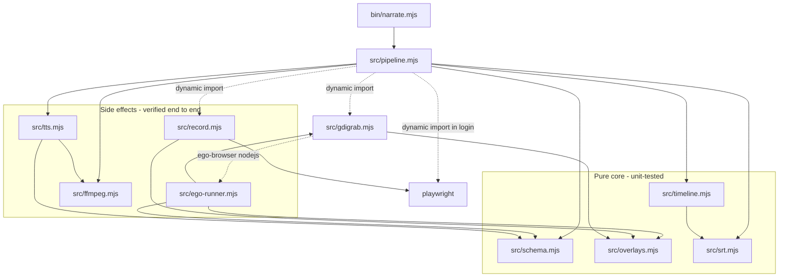
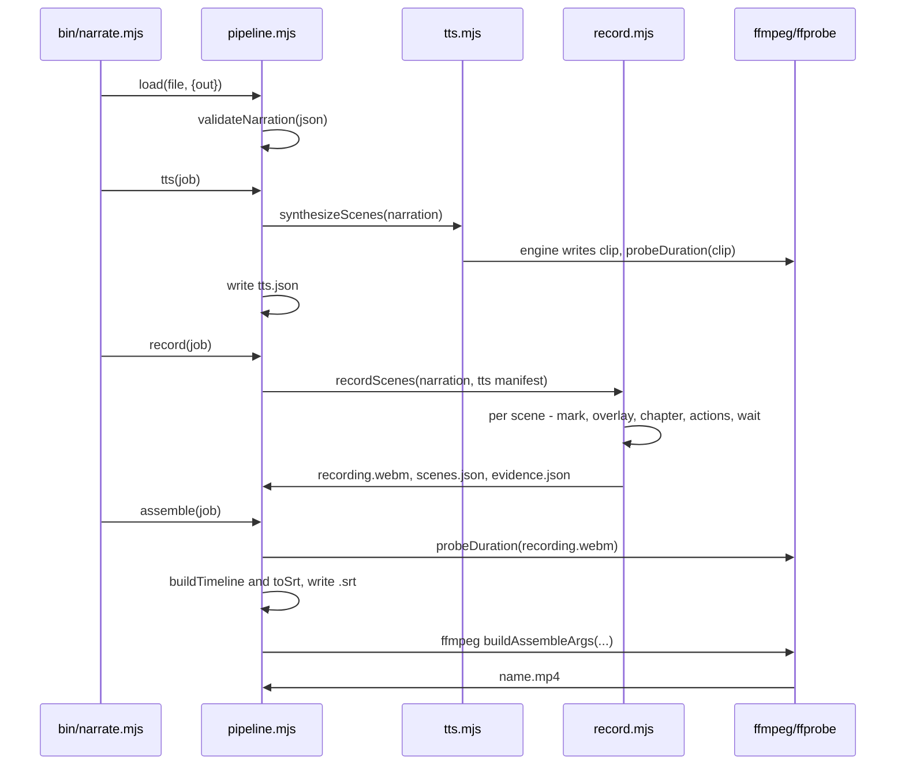

# Code flow

The code splits into a **pure core** (schema, timeline, SRT, ffmpeg and gdigrab argument builders, region math, overlay markup) that is unit-tested, and **side-effecting modules** (TTS engines, Playwright recording, the ego-browser runner, process spawning) that are verified end to end. `bin/narrate.mjs` parses arguments, `src/pipeline.mjs` runs each command, and the commands talk to each other only through JSON files in the working directory (`tts.json`, `scenes.json`).

For the user-facing process and the technologies, see [workflow.md](workflow.md).

## Module map

| File | Responsibility | Key exports |
|---|---|---|
| `bin/narrate.mjs` | Argument parsing, usage text, exit codes | `main` (bin/narrate.mjs:30), `USAGE` (bin/narrate.mjs:6) |
| `src/pipeline.mjs` | One function per command; file I/O between steps | `load` (src/pipeline.mjs:11), `tts` (:34), `recordedVideo` (:41), `record` (:43), `login` (:54), `assemble` (:78) |
| `src/schema.mjs` | Validates `narration.json` and applies defaults | `validateNarration` (src/schema.mjs:22), `ACTIONS` (:3), `ENGINES` (:7), `RECORDERS` (:8), `GDIGRAB_UNSUPPORTED` (:10), `DEFAULT_VOICES` (:11); internal `validateAction` (:120) |
| `src/tts.mjs` | Engine order, cache, synthesis per scene | `engineOrder` (src/tts.mjs:11), `voiceFor` (:17), `cacheKey` (:21), `synthesize` (:60), `synthesizeScenes` (:79); internal `EXT` (:9), `engines` (:31) |
| `src/record.mjs` | Playwright recording, evidence capture | `recordScenes` (src/record.mjs:12), re-exports `captionHtml` / `calloutHtml` (:10); internal `runAction` (:86) |
| `src/overlays.mjs` | Overlay markup for both recorders and the in-page mount helper | `captionHtml` (src/overlays.mjs:16), `calloutHtml` (:22), `chapterHtml` (:32), `calibrationHtml` (:43), `domOverlay` (:54), `CALIBRATION_COLOR` (:12) |
| `src/gdigrab.mjs` | gdigrab pure helpers + the launcher that runs the ego runner | `contentRegion` (src/gdigrab.mjs:25), `windowArea` (:37), `buildGdigrabArgs` (:46), `buildFrameGrabArgs` (:56), `detectRegion` (:68), `isCssSelector` (:92), `showWindowScript` (:100), `recordGdigrab` (:126) |
| `src/ego-runner.mjs` | Runs **inside** `ego-browser nodejs`: page, calibration, capture, scenes | `main` (src/ego-runner.mjs:24), `mount` (:179), `runAction` (:194); internal `showSpaceWindow` (:98), `locateRegion` (:111), `startCapture` (:158) |
| `src/timeline.mjs` | Scene marks → video segments, audio placements, cues | `buildTimeline` (src/timeline.mjs:12) |
| `src/srt.mjs` | Cue splitting and SubRip formatting | `splitCue` (src/srt.mjs:6), `toSrt` (:50) |
| `src/ffmpeg.mjs` | ffmpeg argument builder, process runner, duration probe | `buildAssembleArgs` (src/ffmpeg.mjs:7), `run` (:34), `probeDuration` (:50) |

## Module dependencies



`src/ffmpeg.mjs` is mixed: `buildAssembleArgs` is pure and tested; `run` and `probeDuration` spawn processes. `record.mjs`, `gdigrab.mjs` and `playwright` are imported lazily (src/pipeline.mjs:45, :48, :55), so `validate`, `tts` and `assemble` never load Playwright. `src/gdigrab.mjs` is mixed too: pure builders plus `recordGdigrab`, which spawns `ego-browser`.

## `narrate run` sequence



## Command call paths

Every command except `login` starts with `load` (src/pipeline.mjs:11): resolve the path, strip a UTF-8 BOM, parse JSON (`<file>: invalid JSON (...)` on failure), call `validateNarration`, compute `workDir` (`--out` or `<script dir>/out/<name>`), create it, compute `output` (script `output` resolved from the script dir, or `<workDir>/<name>.mp4`) and `cacheDir` (`<script dir>/.cache/tts`).

| Command | Call path | Reads | Writes |
|---|---|---|---|
| `validate` | `main` → `load` → prints title, scene count, output and each scene's action count | script | nothing (creates `workDir`) |
| `tts` | `main` → `load` → `tts` → `synthesizeScenes` → `synthesize` per scene | script | `tts.json`, clips in `.cache/tts/` |
| `record` | `main` → `load` → `record` → `readJson(tts.json)` → `recordScenes`. With `recorder: "gdigrab"`: `record` → `recordGdigrab` → `ego-browser nodejs` → `ego-runner.main` | `tts.json`, `actionsModule`, `storageState` | `recording.webm` or `recording.mp4`, `scenes.json`, `evidence.json`, `*.png` (gdigrab also `ego-input.json`, `ego-entry.mjs`) |
| `assemble` | `main` → `load` → `assemble` → `recordedVideo(scenes.json)` → `probeDuration` → `buildTimeline` → `toSrt` → `run('ffmpeg', buildAssembleArgs(...))` | `tts.json`, `scenes.json`, the video named in it | `<name>.mp4`, `<name>.srt` next to it |
| `run` | `tts`, then `record`, then `assemble` in the same process | as above | as above |
| `login` | `main` → `login(url, save)` (no `load`) | nothing | `--save` file, default `.cache/auth/state.json` relative to the current directory |

A missing input file fails with `<path> not found; run "narrate tts" first` (or `"narrate record"`), from `readJson` (src/pipeline.mjs:29).

**Exit codes** (bin/narrate.mjs:30–80):

| Code | When |
|---|---|
| `0` | Success, or `-h` / `--help` / no command (prints usage) |
| `1` | Any thrown error, printed as `narrate: <message>` |
| `2` | Usage error: unknown command, missing file or URL, `--out` / `--save` without a value |

## Deep dives

### Schema validation (`src/schema.mjs`)

`validateNarration` collects **every** problem before failing, then throws one error:

```text
Invalid narration:
  - title: required string
  - scenes[0].actions[0]: unknown action "clik"
  - scenes[1].id: duplicate "a"
```

Paths use `field`, `parent.child` and `scenes[i].actions[j]` notation. Each action must be an object with exactly one key from `ACTIONS`; `validateAction` (src/schema.mjs:120) checks its value shape. With `recorder: "gdigrab"`, actions in `GDIGRAB_UNSUPPORTED` fail as `scenes[i].actions[j]: "call" is not supported with recorder gdigrab`.

Defaults applied:

| Field | Default |
|---|---|
| `viewport` | `{ width: 1366, height: 768 }` |
| `tts` | `engine: 'edge'`, `voice: DEFAULT_VOICES[engine]`, `rate: '+0%'`, `fallback: true` |
| `browser` | `channel: 'chrome'`, `headless: true`, `locale: 'es-CO'`, `storageState` unset |
| `captions`, `showActions` | `true` |
| `gapMs` | `400` |
| `recorder` | `'playwright'` (or `'gdigrab'`) |
| `gdigrab` | `{ framerate: 25, drawMouse: true, tab: 'new' }`; `tab` only accepts `"new"` |
| scene `actions` / `speedup` | `[]` / `1` |

### TTS fallback chain and cache (`src/tts.mjs`)

1. `engineOrder(engine, fallback, env)` returns `[engine, ...the others in ENGINES order]` when `fallback` is on, else `[engine]`. Deepgram is removed when neither `DEEPGRAM_API_KEY` nor `DEEPGRAM_API_KEY_FILE` is set.
2. `voiceFor(tts, engine)` uses the configured voice only for the configured engine; fallback engines use `DEFAULT_VOICES`. An edge voice name is never sent to SAPI.
3. `synthesize` (src/tts.mjs:60) builds the file name `cacheKey({engine, voice, rate, text})` + `.` + `EXT[engine]`. The key is the first 16 hex characters of a SHA-256 over the four values joined by `\u0000`. If the file exists, synthesis is skipped (src/tts.mjs:67).
4. The clip is measured with `probeDuration`. Any error (synthesis or probe) moves to the next engine. A fallback is logged as `tts: fell back to <engine> (...)`. If every engine fails: `tts: every engine failed` plus one line per engine.
5. `synthesizeScenes` skips scenes without `say` and returns `{ [sceneId]: { file, duration, engine, voice } }`, which becomes `tts.json`.

Engines (`engines`, src/tts.mjs:31):

| Engine | Implementation |
|---|---|
| `edge` | `run(python, ['-m', 'edge_tts', '--voice', ..., '--rate=...', '--text', ..., '--write-media', file])`; Python from `NARRATE_PYTHON`, default `python` |
| `deepgram` | `fetch` POST to `https://api.deepgram.com/v1/speak?model=<voice>&encoding=mp3` with `Authorization: Token <key>` |
| `sapi` | PowerShell `System.Speech.Synthesis.SpeechSynthesizer`, text piped through stdin as UTF-8, writes a WAV |

### Recording loop (`src/record.mjs`)

Setup in `recordScenes` (src/record.mjs:12):

- Imports `actionsModule` (resolved from the script dir) if set.
- Launches Chrome with `browser.channel` / `browser.headless`; the context gets `viewport`, `locale`, `deviceScaleFactor: 1` and `storageState` (resolved from the script dir).
- Listens for evidence: every response goes into a `responses` list (used by `waitForResponse`); status ≥ 400 also goes into `evidence.responses`; `console` errors and `pageerror` go into `evidence.console`.
- `page.screencast.start` (src/record.mjs:39) writes `recording.webm`. `t0` is taken right after start; `showActions({ position: 'top-right' })` runs if `showActions` is on.

Per scene (src/record.mjs:46–68):

1. **Mark:** push `{ id, start: now() }` (seconds since `t0`).
2. **Caption:** if `captions` and `say`, `showOverlay(captionHtml(say))`; the handle goes into `disposables`.
3. **Chapter:** if set, `showChapter(title, { description, duration: durationMs ?? 2000 })`.
4. **Actions:** `runAction` for each, in order (src/record.mjs:86).
5. **Wait rule:** `narrationMs = duration * 1000 + gapMs` (0 without audio); wait whatever is left since the scene started (src/record.mjs:62–64). Result: a scene lasts `max(actions, narration + gapMs)`.
6. **Dispose** caption and persistent overlays, so they never leak into the next scene.

After the last scene it waits 500 ms. In a `finally` block it stops the screencast, closes the browser and writes `scenes.json` (`{ total, video: 'recording.webm', recorder: 'playwright', scenes: [{ id, start }] }`) and `evidence.json` (times converted to seconds since `t0`). These files are written even if an action throws.

Action notes:

| Action | Behavior |
|---|---|
| `goto` | Resolved against `baseUrl` with `new URL(v, baseUrl)`; waits for `load` |
| `overlay` | `showOverlay(calloutHtml(v))`. With `durationMs` Playwright removes it; without it, it stays until the scene ends. |
| `waitForResponse` | Returns at once if a response whose URL contains `v` already arrived **in this scene** (the click that triggered it ran earlier); otherwise waits for the next match (src/record.mjs:113) |
| `call` | Calls `actionsModule[v](page, { narration, scene })`; throws if the export is missing |
| `screenshot` | Saves `<workDir>/<v>.png` |

### gdigrab recorder (`src/gdigrab.mjs`, `src/ego-runner.mjs`)

ego-browser is not Playwright. Scripts run inside `ego-browser nodejs` with a global `taskSpace()`, do not inherit argv or the shell environment, and must use absolute forward-slash paths. So the pipeline hands everything over in a JSON file:

```mermaid
sequenceDiagram
    participant G as gdigrab.recordGdigrab
    participant E as ego-browser nodejs
    participant R as ego-runner.main
    participant F as ffmpeg gdigrab
    G->>G: write ego-input.json + ego-entry.mjs in workDir
    G->>E: spawn without a shell: nodejs -e "await import('file:///.../ego-entry.mjs')"
    E->>R: main(ego-input.json)
    R->>R: validateNarration, read tts.json
    R->>R: taskSpace("narrate-<name>"), first Page, goto the first URL
    R->>R: showSpaceWindow (PowerShell ShowWindow + SetForegroundWindow)
    R->>F: locateRegion: magenta overlay, grab 1 raw frame, detectRegion
    R->>F: startCapture(buildGdigrabArgs) to recording.mp4
    R->>R: wait 800 ms, then scenes (mark, caption, chapter, actions, wait rule)
    R->>F: write "q" to stdin, await exit
    R->>R: scenes.json + evidence.json; task.finish({ keep: [] }) in finally
    E->>G: exit code and streamed [ego] log lines
```

**Region math.** `contentRegion` (src/gdigrab.mjs:25) turns `window` metrics (CSS px) into the page rectangle in physical px. Measured on ego lite 0.6.2.7, maximized on a 1920×1200 monitor at 125 %: `outerWidth × outerHeight` 1536×912, `innerWidth × innerHeight` 1284×859, `devicePixelRatio` 1.25; in a desktop grab the page spans x 308..1913 and y 59..1133. ego has a vertical tab strip on the left, so a symmetric-border rule (`(outer - inner) / 2`) gives x = 157, which is wrong. The page is anchored bottom-right inside a 7 px frame (`EGO_FRAME_PX`):

```text
x      = round((screenX + outerWidth  - innerWidth)  * dpr) - 7   = round(252 * 1.25) - 7 = 308
y      = round((screenY + outerHeight - innerHeight) * dpr) - 7   = round(53 * 1.25) - 7  = 59
width  = even(floor(innerWidth  * dpr))                           = 1604  (1605 -> even)
height = even(floor(innerHeight * dpr))                           = 1072  (1073.75 -> even)
```

Even sizes are required by `libx264` + `yuv420p`. The formula is only a first guess. `locateRegion` (src/ego-runner.mjs:111) mounts a full-viewport `#FF00FF` box, grabs one raw RGB frame of the window area (`windowArea`, `buildFrameGrabArgs`) and uses the bounding box from `detectRegion` (at least 1 % of the area, tolerance 40). This also proves that the page is visible and painted. The log says whether the calibrated region matches the formula. If the color is not found, the runner raises the window once more and polls for 60 s, then throws `gdigrab: the page of task space "..." never became visible on screen`. The window must be on the primary monitor (CSS `screenX` × `dpr` is only valid there).

**Timing approximation.** ffmpeg needs a moment to open the device, so the runner waits 800 ms after spawn and counts scene starts from `spawn + 800 ms`. The first frame arrives somewhat after spawn, so marks can be off by the rest of the startup time (tens to a few hundred ms). The 400 ms `gapMs` absorbs this for the voice.

**Overlays.** `domOverlay` (src/overlays.mjs:54) is serialized into the page by `page.evaluate`. It replaces the element with the same id (`__narrate_caption`, `__narrate_callout_<n>`, `__narrate_chapter`, `__narrate_calibrate`) with a fixed host that has `pointer-events:none` and `z-index:2147483647`, and removes it after `durationMs`. The runner remembers mounted overlays and re-mounts them after every `goto`. Chapter cards block for their `durationMs` (default 2000), like `showChapter`. The first `goto` runs before the capture (to measure the window), so the scene that holds it does not reload the page.

| Action | ego API |
|---|---|
| `goto` | `page.goto(url, { waitUntil: 'load' })`, then re-mount overlays |
| `click`, `hover` | `page.click` / `page.hover`, with a `label` when `showActions` (ego's native pointer highlight) |
| `check` | No documented API. Raw CSS: skip if `.checked` (via `page.evaluate`), else `page.click` |
| `fill`, `select`, `press` | `page.fill`, `page.selectOption`, `page.press` or `page.keyboard.press` |
| `scroll` | Raw CSS: `page.evaluate(scrollIntoView)`. ego selector: `page.hover` (auto-scrolls). `{ y }`: `page.mouse.move` to the center + `page.mouse.wheel` |
| `waitFor` | Raw CSS: `page.waitForFunction` (attached / detached / visible / hidden; the selector is the argument). ego selectors: `page.waitForSelector` |
| `overlay`, `screenshot` | DOM callout; `page.screenshot({ path })` |
| `call`, `waitForResponse` | Rejected by the schema |

**Window visibility.** ego lite keeps each Agent task space in its own top-level window, hidden unless that space is selected in its UI. `showWindowScript` (src/gdigrab.mjs:100) finds the `ego` process window whose title equals the space name and calls `ShowWindow(SW_MAXIMIZE)` + `SetForegroundWindow`. In our tests the window became visible but stayed unpainted, and `Browser.setWindowBounds` on it made ego hide it again. The calibration step catches this case.

### Timeline math (`src/timeline.mjs`)

`buildTimeline({ total, scenes })` walks the scenes and keeps an output clock `out`:

- A scene spans from its `start` to the next scene's `start` (or `total`). Any lead-in before the first scene is kept at normal speed.
- Its audio is placed at the current `out` and its cues come from `splitCue(say, at, audioDuration)`.
- With `speedup > 1`, the scene splits at `start + audioDuration`: normal speed up to there, then `speedup` for the rest.
- Each segment adds `(to - from) / speed` to `out`. Segments shorter than 0.5 ms are dropped.

In `assemble`, `total` is `min(scenes.json total, ffprobe duration of the recorded video)` (src/pipeline.mjs:82).

**Worked example** (test `buildTimeline speeds up only the part of a scene after its narration`, test/core.test.mjs:78):

Input: `total: 30`; scene `a` at 0 s with 2 s of audio and `speedup: 4`; scene `b` at 22 s with 3 s of audio.

| Step | Segment | Output time added | `out` after |
|---|---|---|---|
| `a` narration | 0 → 2 at ×1 | 2 s | 2 |
| `a` rest | 2 → 22 at ×4 | 20 / 4 = 5 s | 7 |
| `b` | 22 → 30 at ×1 | 8 s | 15 |

Result: audios at `a: 0`, `b: 7`; cues `Esperando` 0–2 s and `Listo` 7–10 s; `duration: 15`.

### ffmpeg filter graph (`src/ffmpeg.mjs`)

`buildAssembleArgs` puts inputs in this order: video (`0`), each audio (`1..n`), then the SRT. For the example above (with `b` at 7.25 s, as in the test), the `-filter_complex` value is:

```text
[0:v]trim=start=0:end=2,setpts=PTS-STARTPTS[v0];
[0:v]trim=start=2:end=22,setpts=(PTS-STARTPTS)/4[v1];
[v0][v1]concat=n=2:v=1:a=0[vout];
[1:a]adelay=0:all=1[a0];[2:a]adelay=7250:all=1[a1];
[a0][a1]amix=inputs=2:duration=longest:normalize=0[aout]
```

(Line breaks added for reading; the real value is one string joined by `;`.)

Then: `-map [vout]`, `-map [aout]` (only with audio), `-map <srtIndex>:s`, `-c:v libx264 -preset medium -crf 20 -pix_fmt yuv420p -r 25`, `-c:a aac -b:a 160k`, `-c:s mov_text -metadata:s:s:0 language=spa`, `-movflags +faststart`, output. Without audio, the `adelay`/`amix` part and the audio flags are omitted.

`run` (src/ffmpeg.mjs:34) spawns with `windowsHide`, supports stdin `input`, and on failure reports the exit code plus the last 5 stderr lines. `probeDuration` (src/ffmpeg.mjs:50) reads `format=duration` from ffprobe.

### SRT splitting (`src/srt.mjs`)

`splitCue(text, start, duration, maxChars = 84)`:

1. Collapse whitespace. If the text fits in `maxChars`, return one cue spanning the whole clip.
2. Otherwise split into sentences on `.`, `!`, `?`, `;`. Sentences still longer than `maxChars` are broken on word boundaries.
3. Time each chunk in proportion to its character count; the last chunk ends exactly at `start + duration`.

`toSrt` numbers the cues and formats timestamps as `HH:MM:SS,mmm`.

## How to extend

### Add an action

1. Add the name to `ACTIONS` (src/schema.mjs:3).
2. If its value is not a plain non-empty string, add a `case` in `validateAction` (src/schema.mjs:102).
3. Add a `case` in `runAction` (src/record.mjs:86) and in `runAction` (src/ego-runner.mjs:194), or list it in `GDIGRAB_UNSUPPORTED`.
4. Document it in the action reference of `skills/narrated-evidence/SKILL.md`.
5. Add a validation test in `test/core.test.mjs` (accepted shape + error message). Check the recording behavior with an end-to-end run.

### Add a TTS engine

1. Add it to `ENGINES` and `DEFAULT_VOICES` (src/schema.mjs:7–8). The position in `ENGINES` sets its fallback order.
2. Add its file extension to `EXT` (src/tts.mjs:9) and an `async ({ text, voice, rate, file })` function to `engines` (src/tts.mjs:31) that writes `file`.
3. If it needs credentials, filter it in `engineOrder` like Deepgram.
4. Update `test/tts.test.mjs` (`engineOrder`, `voiceFor`) and the `engine` error message test in `test/core.test.mjs` (it lists the engines). Update the README voice table and the usage text in `bin/narrate.mjs`.

### Change the output encoding

Edit the codec flags at the end of `buildAssembleArgs` (src/ffmpeg.mjs:7); `crf` is already a parameter (default 20). Update the `buildAssembleArgs` tests in `test/core.test.mjs`, which assert `libx264`, `yuv420p`, `aac` and `mov_text`.

## Testing

```bash
npm test   # node --test "test/*.test.mjs"
```

| Unit-tested (29 tests) | Verified end to end only |
|---|---|
| `validateNarration` defaults, error paths, recorder options, gdigrab-unsupported actions | `recordScenes` / `runAction` (needs Chrome) |
| `buildTimeline` (normal, speedup, no narration) | TTS engines `edge` and `sapi` (network / Windows) |
| `splitCue`, `toSrt` | `deepgram` (not exercised yet: no key) |
| `buildAssembleArgs` (with and without audio) | `run`, `probeDuration`, `login` |
| `engineOrder`, `voiceFor`, `cacheKey` | Full `run` on `examples/bug-demo/` |
| `contentRegion`, `windowArea`, `buildGdigrabArgs`, `buildFrameGrabArgs`, `detectRegion`, `isCssSelector`, `recordedVideo` | `ego-runner.mjs`: actions and DOM overlays checked inside ego; full live capture blocked by the hidden window |
| Overlay markup, `domOverlay` (fake DOM) | `recordGdigrab`, `showWindowScript` |

**Windows gotcha:** use `node --test "test/*.test.mjs"` (what `npm test` runs). A bare `node --test test/` fails on Windows.
