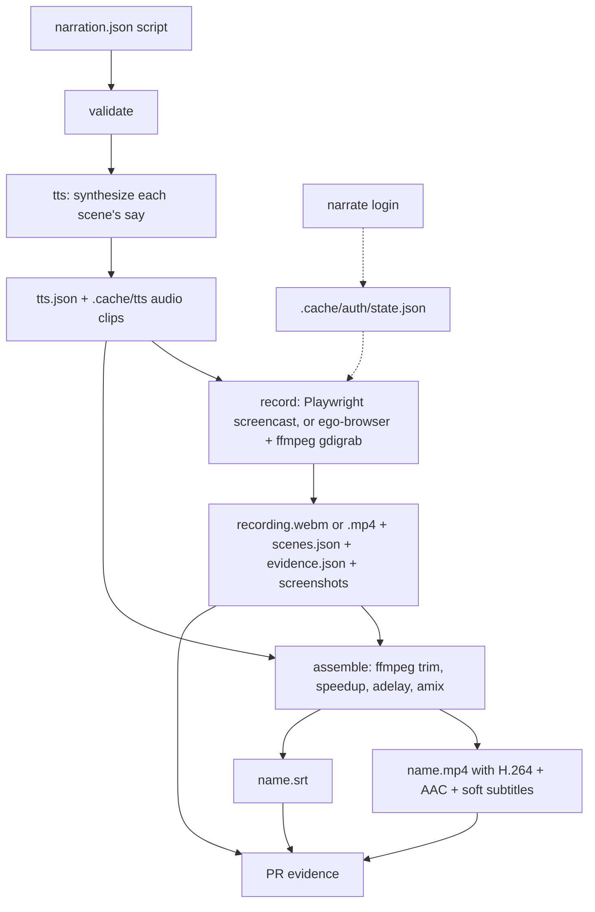

# Workflow and technologies

`narrate` turns a JSON script (`narration.json`) into a narrated MP4 with soft subtitles, a matching `.srt` and an `evidence.json` of failed requests and console errors. You describe each scene once (what to say + what to do in the browser). The tool generates the voice first, records the browser so that every scene lasts at least as long as its narration (headless Chrome by default, or the real ego-browser window with `"recorder": "gdigrab"`), then mixes everything with ffmpeg. You never narrate or edit video by hand.

This doc explains the process and the moving parts. For the internals, see [code-flow.md](code-flow.md).

## Quick path

1. **Write the script.** Copy a template from `skills/narrated-evidence/assets/` (bug or feature) and fill `title`, `baseUrl`, scenes and selectors.
2. **Validate it.** `node bin/narrate.mjs validate <file>`. Fix every reported path (for example `scenes[1].speedup: must be a number >= 1`).
3. **Sign in, only if the app needs a session.** `node bin/narrate.mjs login <url> --save <state.json>`, sign in on the window, close it, then set `browser.storageState` in the script.
4. **Run.** `node bin/narrate.mjs run <file>` (or `tts`, `record` and `assemble` one by one).
5. **Check.** Look at frames at the scene starts from `scenes.json`, confirm the audio and read `evidence.json`.
6. **Deliver.** Attach `<name>.mp4` and `<name>.srt` to the PR. Delete the session file.

```bash
node bin/narrate.mjs run examples/bug-demo/narration.json
# -> examples/bug-demo/out/narration/narration.mp4 + narration.srt
```

## End-to-end process



`run` is simply `tts` → `record` → `assemble`. Each step reads the previous step's files from `out/<name>/`, so you can repeat one step alone. Example: `assemble` alone re-renders the video without recording again.

## Choosing the recorder

| | `"recorder": "playwright"` (default) | `"recorder": "gdigrab"` |
|---|---|---|
| Browser | Fresh headless Chrome | A task space in your running ego-browser |
| Video source | `page.screencast` → `recording.webm` | `ffmpeg -f gdigrab` on the page's screen rectangle → `recording.mp4` |
| Session | `narrate login` + `browser.storageState` | Your ego profile: sign in to the app in ego beforehand |
| Overlays | Playwright `showChapter` / `showOverlay` / `showActions` | Same markup injected into the page DOM; ego's own pointer highlight for clicks |
| Native popups, OS dialogs | Not visible | Visible (it is a screen grab) |
| `call` / `actionsModule`, `waitForResponse` | Supported | Rejected by `validate` |
| `evidence.json` | Failed responses + console errors | Empty, with `note: "not collected with recorder gdigrab"` |
| Unattended | Yes | No: Windows only, the window must stay visible and unobstructed on the primary monitor, and you may have to select the task space in ego |

Pick `gdigrab` only when the video must show something Playwright cannot (native popups, the user's real logged-in ego session). Everything else uses `playwright`.

## How sync works (3 phases)

The voice never runs ahead of the screen because the audio exists before recording starts.

| Phase | Command | What happens |
|---|---|---|
| 1. Audio first | `tts` | Each scene's `say` is synthesized and its duration is measured with `ffprobe`. Result: `tts.json`. |
| 2. Record to the audio | `record` | Either recorder. Each scene runs its actions, then waits until `narration duration + gapMs` (400 ms by default) has passed since the scene started. A scene lasts `max(actions, narration + gapMs)`. The real start time of each scene goes to `scenes.json`. |
| 3. Assemble | `assemble` | The recording is cut per scene. Each audio clip is placed at its scene start (`adelay` + `amix`). In scenes with `speedup`, only the part **after** the narration is accelerated, so the voice never plays over fast-forwarded video. |

Example: a scene with 2 s of narration waits 20 s for the backend and has `"speedup": 4`. The output keeps 2 s at normal speed, then plays the 20 s wait in 5 s.

## Technologies

| Technology | Role | Why chosen | Limits |
|---|---|---|---|
| **Node 22** (ESM, `node:test`) | Runtime for the CLI, the pipeline and the tests | No build step. The built-in test runner keeps dependencies at zero, except Playwright. | Windows: run tests with `node --test "test/*.test.mjs"` (bare `test/` fails). |
| **Playwright 1.65** `page.screencast` | Drives the browser and records the video. `showChapter` (title cards), `showActions` (highlighted clicks), `showOverlay` (captions and Actual/Expected callouts). | Recording, action highlighting and overlays in one API (≥ 1.59). Uses the system Google Chrome (`channel: "chrome"`), so no browser download is needed. | Needs `npx playwright install ffmpeg` for its screencast encoder. Cannot show native `<select>` popups or OS dialogs. Records a fresh browser, not your open session. |
| **edge-tts** (Python) | Default voice engine. Default voice `es-CO-SalomeNeural` (male: `es-CO-GonzaloNeural`). | Free, natural neural voices in Colombian Spanish. | Unofficial client of a Microsoft service: needs internet and may change without notice. Needs `pip install edge-tts`. `NARRATE_PYTHON` picks the Python. |
| **Deepgram** `aura-2-celeste-es` | First fallback (paid API) | Stable, official API if edge-tts fails | Needs `DEEPGRAM_API_KEY` or `DEEPGRAM_API_KEY_FILE`; skipped without one. **Implemented but not exercised yet** (no key during testing). |
| **Windows SAPI** (`Microsoft Helena Desktop`) | Offline last resort | Works with no network and no install on Windows (through PowerShell `System.Speech`). | Windows only. Robotic voice quality. |
| **ego-browser** (ego lite 0.6.2.7) | Drives the page in gdigrab mode through `ego-browser nodejs` and its task-space API | Uses the user's real browser profile and session; selectors include `loc=role:...` and `@ref` | Not Playwright: small documented API. Agent task-space windows are hidden unless selected in ego (see Limits). |
| **ffmpeg gdigrab** | Screen capture of the page rectangle (`libx264 -preset ultrafast -crf 18`) plus one raw frame for calibration | Free, already installed with ffmpeg, no extra driver | Windows only; records whatever is on screen in that rectangle. |
| **ffmpeg / ffprobe** (on PATH) | `ffprobe` measures clip and recording durations. `ffmpeg` cuts (`trim`), speeds up (`setpts`), joins (`concat`), places audio (`adelay` + `amix`) and encodes `libx264` + `aac` + `mov_text` subtitles. | Standard tool, scriptable, one command does the whole edit. | Must be installed separately and on PATH. |

Engine order with `tts.fallback: true` (the default): the chosen engine first, then the others in `edge → deepgram → sapi` order. Deepgram is dropped when no key is set. With `fallback: false`, only the chosen engine runs.

## Artifacts

`<name>` is the script file name without extension. By default the working directory is `out/<name>/` next to the script; `--out <dir>` changes it, and `output` in the script changes the final MP4 path.

| File | Written by | Read by | Content |
|---|---|---|---|
| `out/<name>/tts.json` | `tts` | `record`, `assemble` | Per scene: audio file, duration, engine, voice |
| `.cache/tts/*.mp3` / `*.wav` (next to the script) | `tts` | `tts` (cache), `assemble` | Audio clips, named by a hash of engine + voice + rate + text. Same text = no new synthesis. |
| `out/<name>/recording.webm` / `recording.mp4` | `record` (Playwright / gdigrab) | `assemble` | Raw screen recording; `assemble` reads the name from `scenes.json` `video` (older runs without it: `recording.webm`) |
| `out/<name>/ego-input.json`, `ego-entry.mjs` | `record` (gdigrab) | `ego-browser nodejs` | Runner inputs (narration, workDir, tts.json paths, space name) and the one-line import entry |
| `out/<name>/scenes.json` | `record` | `assemble`, you (frame checks) | `total`, `video`, `recorder`, real `start` (seconds) of each scene; gdigrab adds the captured `region` in physical pixels |
| `out/<name>/evidence.json` | `record` | you (bug evidence) | Responses with status ≥ 400 and console errors, timed from the recording start |
| `out/<name>/<shot>.png` | `record` (`screenshot` action) | you | Still images |
| `out/<name>/<name>.mp4` (or the script's `output`) | `assemble` | PR reviewers | Final video: H.264 + AAC + soft subtitles (`mov_text`, language `spa`) |
| `<name>.srt`, always next to the MP4 | `assemble` | PR reviewers | Same captions as the MP4, for watching without sound |
| `.cache/auth/state.json` (default of `login`, relative to where you run it) | `login` | `record` via `browser.storageState` | Live session: cookies + localStorage |

`out/`, `.cache/` and `*.webm` are in `.gitignore`.

## Writing the script

One scene = one idea, one or two sentences. The voice describes what is on screen in that scene, never what comes next.

| Template | Scene order | Use for |
|---|---|---|
| `assets/bug-template.json` | contexto → pasos → espera (`speedup`) → actual (red callout) → esperado (green) → evidencia → impacto | Bug reports |
| `assets/feature-template.json` | problema → recorrido → casos borde → cierre | Feature / PR demos |

A scene looks like this:

```json
{
  "id": "actual",
  "say": "Resultado actual: aparece el mensaje Pasajero guardado correctamente.",
  "actions": [{ "overlay": { "kind": "actual", "text": "Muestra «Pasajero guardado correctamente»" } }, { "screenshot": "actual" }]
}
```

Tips:

- Put slow backend waits in their own scene with `"speedup": 4`.
- For mocking or complex steps, export `async (page, ctx)` functions from an `actionsModule` and call them with `{ "call": "name" }`. `examples/bug-demo/actions.mjs` mocks the backend with `page.route`.
- For the `evidencia` scene of a bug, do a first run, read `evidence.json`, and put the real request and status in the callout.

The full action and field reference lives in [`skills/narrated-evidence/SKILL.md`](../skills/narrated-evidence/SKILL.md#action-reference). `examples/bug-demo/` is a complete working example.

## Security and data rules

- **Never type passwords in a script.** The user runs `narrate login <url>` and signs in by hand; the session is saved as Playwright `storageState`.
- **The state file is a live session.** Keep it out of git and delete it after recording.
- **Use only confirmed test data.** New records get a `QA_` prefix. Never edit or delete existing records.
- **Keep outputs out of git** (`out/`, `pr-assets/`). Attach them to the PR instead.
- **Check nondeterministic flows** in the recorded frames. If the screen contradicts the voice, record again.

## Limits and pending work

| Item | Status |
|---|---|
| Native `<select>` popups and OS dialogs | Not visible in Playwright recordings. Use screenshots or describe it. |
| Recording your live ego-browser window (ffmpeg gdigrab) | Implemented (`"recorder": "gdigrab"`). Unit-tested math and args; actions and DOM overlays verified inside ego. **A full live recording is not verified yet**: ego lite 0.6.2.7 keeps Agent task-space windows hidden, and raising one with Win32 `ShowWindow` leaves it unpainted. The runner waits 60 s for you to select the space in ego, then fails with a clear message. Raising the window can leave ego's space switcher out of sync until you click a space. |
| gdigrab and multiple monitors / scaling | The window must be on the primary monitor. Scaling is handled: the region is measured in physical pixels (125 %: viewport 1284×859 CSS ↔ 1604×1072 physical). |
| Deepgram fallback | Implemented, not exercised (no API key during testing). |
| edge-tts availability | Depends on an unofficial Microsoft endpoint; SAPI covers offline use. |

## Next step

To change or extend the code (new actions, new TTS engines, encoding), read [code-flow.md](code-flow.md).
